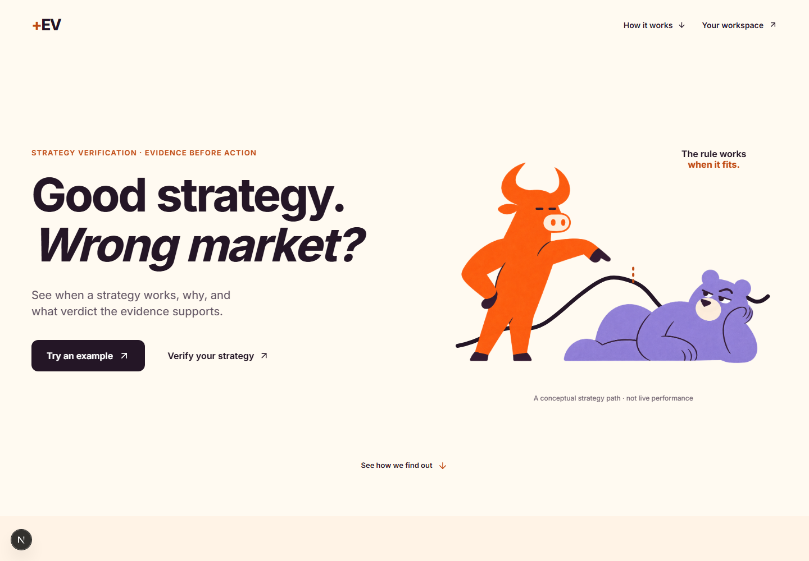
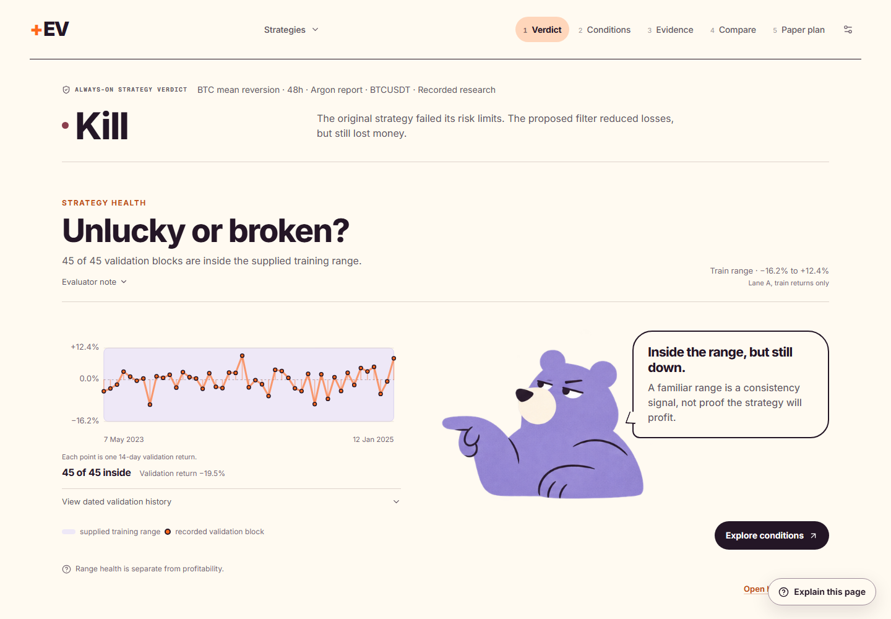
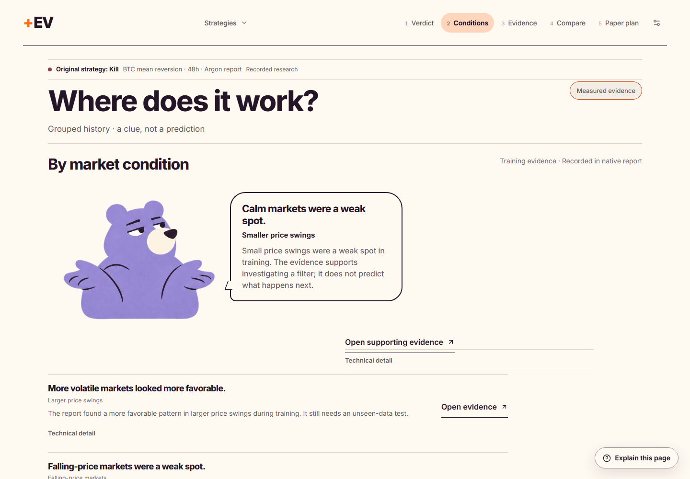
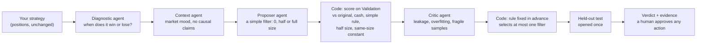
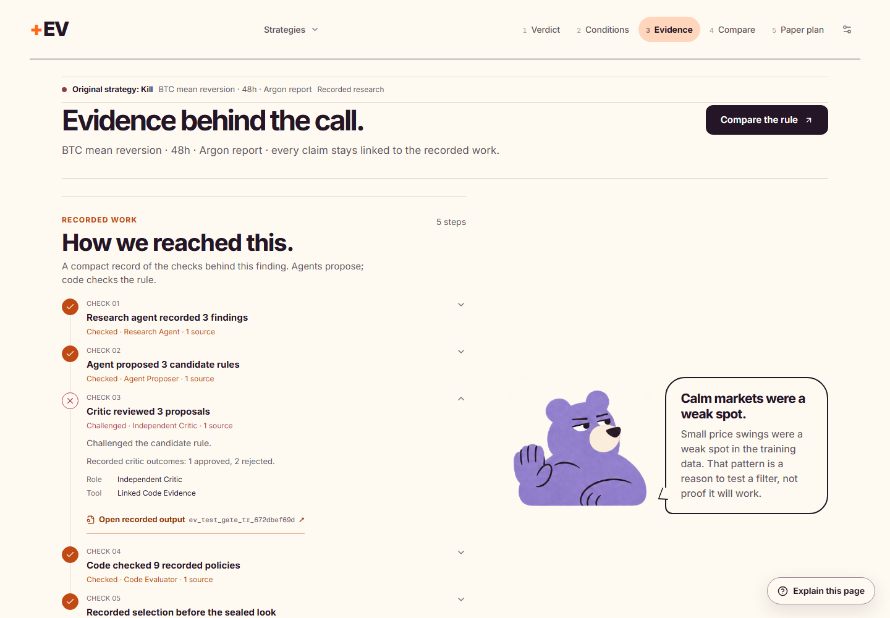

# +EV

## Good strategy. Wrong market?

**+EV tests automated trading strategies, finds where they struggle, and checks every proposed fix on data kept out of the research.**

AI agents investigate the market conditions behind a strategy's wins and losses, propose a simple allocation filter, and challenge each other's explanations. Code computes every number and makes every decision. The workspace gives one verdict, the reason, and the evidence behind it.

**Keep · Restrict · Kill · Not proven**

Built for **prop firms, copy-trading platforms and bot marketplaces**, which decide every day which strategies keep their capital.



*AgentVerse 2026 · UCL · Finance track · Research prototype · Paper only, no live orders*

[Results](#what-we-found-honestly) · [Demo](#the-two-minute-demo) · [How it decides](#how-a-decision-is-made) · [Testing](#testing-on-data-the-research-never-touched) · [Risk controls](#risk-controls-enforced-in-code-shown-live) · [Run it](#run-ev-locally)

---

## What we found, honestly

Two fixed demo strategies, run on real Binance BTCUSDT hourly data from 2018-02 to 2026-10 with fees and slippage. The research agents ran on Gemini 4 Argon.

| | BTC trend 24/72 | BTC mean reversion 48 |
|---|---|---|
| **Verdict** (for the original strategy) | **Not proven** | **Kill** |
| Why | The held-out intervals contain zero. The critic rejected all 3 agent filters. | Held-out drawdown was 60.4%, past the 40% cap, and its return interval is entirely below zero. |
| Best agent filter | None selected | Half size when 7-day volatility is below its Training median |
| That filter on the held-out test | — | **+27.3 pp** better than the original (90% interval +15.3 to +36.2), drawdown 60.4% → 36.2%, **but its own return was −28.9%** |
| Timing or just less risk? (Validation) | The Fear & Greed filters were at about 0.97× size on Validation; the critic's rejection stands | Beat constant half size by 15.7 pp and same-size constants by 17–21 pp: some sign of timing, not proof |
| Organisers' hidden challenge (300 unseen paths) | Untestable: paths are shorter than the strategy's 72-bar warm-up | Filter better than no filter on 53 paths, worse on 12 (p = 3×10⁻⁷), **but cash beat it 56 to 8** |

**The honest reading.** The agents found a filter that reliably loses less, mostly by holding less of a losing strategy. A strategy that loses money with or without the filter is a kill, not a fix. The system says so even though the AI found something that looks good. Plain-language reports: [trend](experiments/readable/btc-trend-24-72-demo.md) · [mean reversion](experiments/readable/btc-meanrev-48-demo.md).

**What this cannot claim.**
- The held-out window (2025-02 → 2026-10) overlaps a period the team had explored earlier, so it was opened once and pre-registered, but it was not data the team had never seen. A clean test needs data after 2026-10-31.
- That window has now been opened, so code refuses any second look at it, whatever the filter.
- The organisers' challenge executes all-in or flat, so the filter's half size becomes flat there.

The full record, every interval and the caveats: [docs/RESEARCH_RECORD.md](docs/RESEARCH_RECORD.md).

---

## The two-minute demo

Start the app and select **Try an example**, then pick **BTC mean reversion · 48h** from the strategy switcher.

| Step | The question it answers |
|---|---|
| **Verdict** | What is the finding, and what should I do next? |
| **Conditions** | Which market conditions go with stronger or weaker results for this strategy? |
| **Evidence → Open agent report** | What did each agent propose, check or challenge, and why did the conclusion change? |
| **Compare** | What exact filter was checked, against which benchmarks? |
| **Plans** | Has the proposal earned a paper plan? (Plans are saved, not running.) |



**What a judge sees first in the agent report:**
- one finding and the next step;
- the three research stages (Training, Validation, Held-out test);
- every checked filter with its outcome: rejected, not run, selected for further testing, or comparison only;
- the agent trace;
- a takeaway with the strategy definition, the exact filter settings and the evidence links.

"Tested" never reads as "passed". IDs, logs and provenance sit one click below.



**The failure that would hurt our user, handled on screen.** A platform keeps funding a strategy because a filter "improved" it by 27 points. +EV shows the filter's own return (−28.9%), the cash comparison and the Kill verdict on the same screen.

---

## How a decision is made



**Agents propose, code decides.**
- Every agent claim must cite the ID of a real tool result.
- A verifier rejects any number that does not match the cited evidence.
- The selection rule was written down before the run: beat the original and cash on Validation after costs, change something real (not one size almost all the time), and not be rejected by the critic. Only the best such filter gets the one held-out look.
- The strategy's own signals are never changed. A filter only sets the position size to 0, half or full.

**The market conditions a filter can use** (all point in time, thresholds from Training quantiles only):

| Condition | Features | Status |
|---|---|---|
| Trend, short vs longer window | 24-hour and 7-day momentum (up / down / sideways labels) | Supported |
| Volatility level and change | 7-day volatility, ATR, 24-hour vs 7-day volatility ratio | Supported |
| Volume | Traded volume vs its 7-day normal | Supported, labelled as a proxy, not liquidity |
| Spreads, order-book depth, quoted slippage | — | **No historical data**; costs stay fixed for every policy |
| Sentiment | Fear & Greed, used the next day | Supported |
| News | — | Refused: no archive with first-seen timestamps |

The direction comes from each strategy's own evidence: low volatility hurts mean reversion and helps trend. Details: [experiments/conditions_check/README.md](experiments/conditions_check/README.md).



---

## Testing on data the research never touched

| | |
|---|---|
| **Data** | Binance spot BTCUSDT hourly bars, 2018-02 → 2026-10 (76,559 bars, 26 missing hours), plus Fear & Greed (Alternative.me), usable the next day |
| **Stages** | Training 2018-02 → 2023-05 · Validation 2023-05 → 2025-02 · Held-out test 2025-02 → 2026-10, opened once after the selecting report was committed |
| **Costs** | Fill at the next bar's open, 10 bp fee + 1 bp slippage, compounded returns |
| **Benchmarks** | Original strategy (always on), cash, a simple rule, constant half size, a constant at the filter's average size, Lane A's regime filter, a LightGBM filter |
| **Uncertainty** | Block bootstrap 90% intervals on every result. An interval that contains zero is "not proven" |
| **Stability** | Three walk-forward Training folds, plus an "unlucky or broken?" check of 14-day Validation blocks against the Training range |
| **Unseen data** | The organisers' `bench.py challenge`: 300 hidden paths per strategy, plan committed before any run ([pre-registration](eval/challenge/kok-preregistration.md), [results](eval/challenge/)) |

**Lower drawdown alone never counts as success.** Every filter is compared with constant half size and with a constant at the same average size, under identical costs, so "it held less" is visible next to "it chose when". ([timing check](experiments/conditions_check/README.md#timing-vs-taking-less-risk))

---

## Risk controls, enforced in code, shown live

```bash
python3 scripts/demo_controls.py            # 4 controls, offline, about 4 seconds; exits 1 if any control fails
python3 scripts/demo_controls.py --only 2   # one control for the live pitch
```

| Control | What happens |
|---|---|
| **Sealed held-out data** | An agent asks for the test split: it is refused, logged, and flagged in the report. |
| **No invented numbers** | A claim with a number not in the cited evidence is rejected, and the agent retries with copied numbers. |
| **AI approval is not enough** | The critic approves a money-losing filter, and the rule fixed in advance rejects it because it does not beat cash. |
| **One look, ever** | A second look at a held-out window is refused, even under a new name or for a different filter. This is kept on disk by spec hash and by experiment. |

Every attempt, including refused ones, is in the report's trial log. The agents have a budget of 12 training tests, and every rule comes from a fixed menu: 1–2 conditions, 5 Training quantiles, sizes 0 / 0.5 / 1.

---

## Who it is for

| Customer | Decision +EV supports |
|---|---|
| **Crypto prop firms** | Which traders keep funding, get limits, or stop? |
| **Copy-trading platforms** | Which strategy providers should be promoted or warned? |
| **Bot marketplaces** | Which listed strategies still justify user trust? |

The first buyer is a head of risk or strategy evaluation who needs a consistent reason for every funding, warning or delisting decision.

**Proposed pilot:** 50 strategies, two weeks, one report each. Success means agreement with the platform's own independent review, and tracking what happens afterwards.

**Business model:** a platform licence priced by the number of strategies monitored.

There is no established moat today. It has to be earned through a timestamped market-context archive and an auditable history of strategy decisions.

---

## Run +EV locally

**Python 3.11+ · Node.js 22+ · npm**

```bash
git clone https://github.com/katrvx/PlusEV.git && cd PlusEV
python -m venv .venv && source .venv/bin/activate          # Windows: .\.venv\Scripts\Activate.ps1
python -m pip install -r A/requirements.txt -r requirements-lane-b.txt -r requirements-lane-c.txt
npm ci
python -m uvicorn apps.api.main:app --host 127.0.0.1 --port 8000
npm run dev                                                  # second terminal → http://127.0.0.1:3000
```

Choose **Try an example**. Recorded reports and the controls demo need no model key. API docs: http://127.0.0.1:8000/docs. On macOS, LightGBM may need `brew install libomp`.

**Reproduce the evidence**

```bash
python3 scripts/render_reports.py                                         # plain-language reports from the committed runs
python3 scripts/timing_check.py --report experiments/investigation_argon_meanrev.json   # Validation only
python3 scripts/run_investigation.py --lane-a --experiment-id btc-meanrev-48-demo --fallback   # agents without a key
KOK_AGENT_MODEL=google:gemini-4-argon GEMINI_API_KEY=... python3 scripts/run_investigation.py --lane-a   # LLM agents
python3 scripts/kok_challenge.py challenge --strategy mean_reversion     # organisers' kit, gated adapter
```

**Bring your strategy.** Upload timestamped BTCUSDT hourly positions as CSV or Parquet; your strategy code can stay private. Strategy-rule JSON saves as a draft. [Input formats](docs/STRATEGY_INPUTS.md)

**Verify the build**

```bash
python -m pytest -q tests/ A/tests
npm run typecheck && npm run build
```

---

## Built as one connected workflow

| Layer | Responsibility | Docs |
|---|---|---|
| **Quant engine** (Lane A) | Market snapshot, point-in-time features, replay with costs, benchmarks, walk-forward folds, the strategy verdict | [A/README.md](A/README.md) |
| **Research agents** (Lane B) | Diagnosis, context, proposals, criticism, number verification, the selection rule, readable reports | [LANE_B.md](LANE_B.md) |
| **Product and API** (Lane C) | Strategy intake, workspace, readable reports, downloads, paper-plan approvals | [LANE_C.md](LANE_C.md) |

Stack: Next.js, React and TypeScript, on FastAPI. Agents are built with PydanticAI on Gemini 4 Argon, with a deterministic fallback.
- [Integration decisions](docs/INTEGRATION_DECISIONS.md)
- [Where we cut scope](docs/LANE_B_DIVERGENCE.md)
- [Research record](docs/RESEARCH_RECORD.md)

Market data: Binance / Binance Vision and Alternative.me. [Data documentation](A/README.md) · [Mascot assets](docs/MASCOT_ASSET_GUIDE.md) · [MIT licence](LICENSE)

**+EV: make every strategy earn its capital.**
