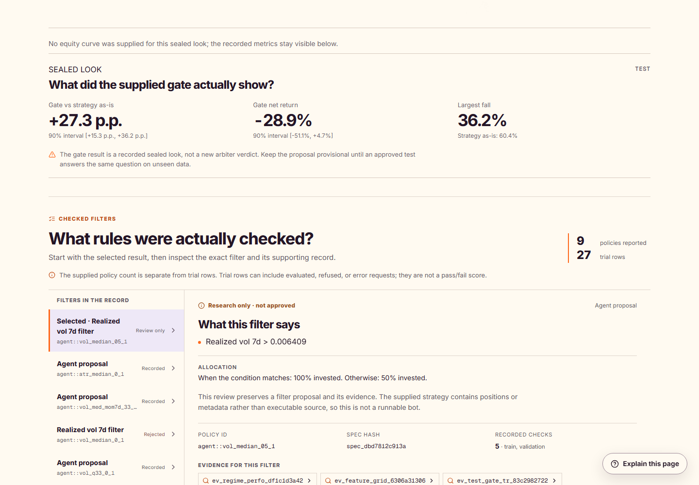

# +EV

## Good strategy. Wrong market?

**Know what deserves capital. Know when to change course.**

+EV turns trading-strategy histories into decisions a team can act on. AI agents investigate market conditions, propose targeted changes and challenge each other's explanations. A quantitative engine checks the numbers. The workspace brings the verdict, reasoning and next action together.

**Keep · Restrict · Monitor · Kill · Not proven**

Built for **copy-trading platforms, prop firms and bot marketplaces** reviewing strategies before capital follows them.

**Recorded BTC result: +27.3 percentage points versus the original strategy, with maximum drawdown reduced from 60.4% to 36.2%.** [See the full comparison](#273-percentage-points-a-clearer-decision).

[Take the two-minute tour](#the-two-minute-demo) · [Meet the agents](#research-agents-that-show-their-work) · [See the evidence](#273-percentage-points-a-clearer-decision) · [Run +EV](#run-ev-locally)


*AgentVerse 2026 · UCL · Finance track*

## The decision behind the drawdown

A strategy starts losing. Do you give it time, reduce its allocation, change the conditions—or switch it off?

That decision is difficult when the explanation is scattered across a backtest, a spreadsheet and someone's market view. +EV brings the investigation into one place:

- **Is this expected?** Compare recent behavior with the strategy's historical range.
- **Where does it struggle?** Examine trend, volatility, volume and sentiment conditions.
- **What should change?** Inspect a proposed rule, its benchmarks and the evidence for the next step.

For a platform reviewing many strategies, the product is a repeatable decision process: **what to fund, what to restrict and what to retire—with a reason attached.**

## The two-minute demo

Start the app and select **Try an example**. The screens below follow **BTC mean reversion · 48h**; select it from the strategy switcher. Follow one strategy through five steps:

| Step | The question it answers |
| --- | --- |
| **Verdict** | What is the main finding, and what should I do next? |
| **Conditions** | Which market conditions are associated with stronger or weaker results? |
| **Evidence** | What did the agents investigate, challenge and verify? |
| **Compare** | What exact filter was checked, and how did it compare with the alternatives? |
| **Paper plan** | Has the proposal earned the next step, and what requires human approval? |


Large contextual guides explain the important finding. Source links let a reviewer go deeper. The strategy review download keeps the original strategy reference, exact filter settings and supporting evidence together.

### Find the market conditions that matter

Move from the headline to a specific condition, its sample and the evidence behind it.


## Research agents that show their work

The agents have distinct jobs, access to bounded tools and outputs that can be checked.

| Role | What it contributes |
| --- | --- |
| **Diagnostic analyst** | Investigates where the strategy behaves differently and cites the supporting observations. |
| **Rule proposer** | Turns an explanation into a simple condition and allocation rule. |
| **Critic** | Challenges fragile samples, changing regimes, overfitting and weak comparisons. |
| **Quantitative engine** | Calculates performance after costs, evaluates benchmarks and applies decision criteria. |


The original strategy's signals stay intact. A proposed gate changes how much exposure to take under a recorded market condition. For example: use the original position above a training-derived volatility threshold, and half-size below it.

**An exact rule. A visible research trail. A clear next step.** +EV puts market conditions, costs and benchmark comparisons in the same review, with the original calculations one click away.


Four controls are demonstrated in executable code: restricted test access, numerical claim verification, rule-based rejection and a single-look ledger. Run them locally with:

```bash
python scripts/demo_controls.py --plain
```

This offline demonstration uses a deliberately misbehaving scripted model against the real control paths. Recorded Gemini 4 Argon research runs are included separately.

## +27.3 percentage points. A clearer decision.

In the recorded BTC mean-reversion study, the proposed volatility filter delivered:

| Recorded comparison | Result |
| --- | --- |
| **Net-return improvement versus the original strategy** | **+27.3 percentage points** |
| **Maximum drawdown** | **60.4% → 36.2%** |
| **90% interval for the improvement** | **+15.3 to +36.2 percentage points** |

The output is concrete: a market condition, an exact allocation rule and a measured comparison. Reviewers can inspect the result and download the strategy reference, filter settings and evidence as one package.

For context, the filtered strategy's own net return was −28.9%. The published Kill applies to the original strategy; the filter did not receive a new arbiter approval. The uplift is a relative improvement, not a +27.3% absolute return.



The trend investigation offers a second example: the critic vetoed all three final agent proposals, preserving an **Inconclusive** result rather than forcing a recommendation.

**Study context:** these are recorded historical BTCUSDT hourly results using data from 2018–2026. The scored period overlaps data previously explored by the team, so it is not a clean team-unseen test. The [research record](docs/RESEARCH_RECORD.md) contains the full methods, intervals and limitations.

The organisers' challenge adds **300 synthetic market paths per strategy**, published commitments and reproducible benchmark comparisons. [Inspect the challenge evidence](eval/challenge/kok-preregistration.md).

[Trend report](experiments/readable/btc-trend-24-72-demo.md) · [Mean-reversion report](experiments/readable/btc-meanrev-48-demo.md) · [Recorded test](experiments/frozen_look_btc-meanrev-48-demo.json)

## A large market. A precise first customer.

Global asset managers oversaw **$147 trillion in 2025**. Capital allocation is an enormous, recurring decision problem. [BCG, Global Asset Management Report 2026](https://www.bcg.com/publications/2026/an-imperative-for-growth-and-the-new-economics-of-asset-management)

+EV starts with the teams evaluating automated strategies:

| Customer | Decision +EV is designed to support |
| --- | --- |
| **Copy-trading platforms** | Which providers deserve visibility, limits or removal? |
| **Crypto prop firms** | Which strategies deserve continued funding or tighter exposure? |
| **Bot marketplaces** | Which strategies can support their claims with reproducible evidence? |

**Planned business model:** platform software priced by the number of strategies reviewed and monitored. The initial pilot offer is a review of 50 strategy histories, producing a decision record for each.

The $147 trillion figure describes the wider asset-management industry. Our first commercial market is the software budget of strategy platforms. From that focused entry point, the expansion path is recurring monitoring, richer market context and integration into allocation reviews.

## Run +EV locally

**Python 3.11+ · Node.js 22+ · npm**

```bash
git clone https://github.com/katrvx/PlusEV.git
cd PlusEV
python -m venv .venv
```

Activate the environment:

```powershell
# Windows PowerShell
.\.venv\Scripts\Activate.ps1
```

```bash
# macOS / Linux
source .venv/bin/activate
```

Install dependencies, then start the API:

```bash
python -m pip install -r A/requirements.txt -r requirements-lane-b.txt -r requirements-lane-c.txt
npm ci
python -m uvicorn apps.api.main:app --host 127.0.0.1 --port 8000
```

In a second terminal:

```bash
npm run dev
```

Open **http://127.0.0.1:3000** and choose **Try an example**. Recorded reports and the offline controls need no model key. API documentation: **http://127.0.0.1:8000/docs**. On macOS, LightGBM may require `brew install libomp`.

### Bring your strategy

The working evaluation path accepts **timestamped BTCUSDT hourly positions** through CSV or Parquet. The importer validates the file, maps the columns and records execution costs. Strategy source code can stay private.

Supported strategy-rule JSON saves as a **draft**; execution currently starts from position histories. Other markets, timeframes and completed trade logs remain available for storage or diagnosis pending evaluator support. [Input formats and examples](docs/STRATEGY_INPUTS.md)

Paper plans are saved review protocols. The prototype does not place live orders or claim completed forward observations.

### Verify the build

```bash
python -m pytest -q tests/ A/tests
node --test tests/web/strategy-review-export.test.cjs
npm run typecheck
npm run build
```

For a fresh development investigation, use [Lane B's research commands](LANE_B.md). The default fallback works without a provider key; optional LLM runs use `KOK_AGENT_MODEL` and the provider credentials in your local environment.

## Built as one connected workflow

| Layer | Responsibility | Documentation |
| --- | --- | --- |
| **Quant engine** | Market snapshots, features, replay, costs, benchmarks and verdicts. | [Lane A](A/README.md) |
| **Research agents** | Diagnosis, proposals, criticism, verification and evidence. | [Lane B](LANE_B.md) |
| **Product and API** | Strategy intake, readable reports, chart interactions, downloads and approvals. | [Lane C](LANE_C.md) |

The workspace uses **Next.js, React and TypeScript**, backed by **FastAPI**, with research agents built using **PydanticAI**. [Shared API contracts](packages/contracts/api.ts) · [Integration decisions](docs/INTEGRATION_DECISIONS.md)

Next: connect rule definitions to evaluation, validate on new prospective data, expand timestamped market context and test recurring reviews with platform teams.

Market data: Binance / Binance Vision and Alternative.me. [Data documentation](A/README.md) · [Mascot assets](docs/MASCOT_ASSET_GUIDE.md) · [MIT licence](LICENSE)

**+EV — make every strategy earn its capital.**
