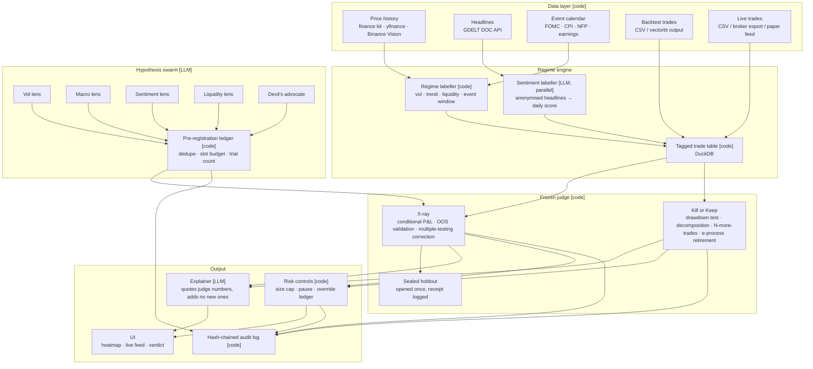

# 02 · Architecture

## Design rule

**Code computes every number. The LLM proposes, labels and explains. It never decides.**

Every box below is marked `[code]` or `[LLM]`. If a box is `[LLM]` and its output is a number that ends up in a verdict, the design is wrong.

## System diagram



## Components

### Data layer `[code]`

- **Prices.** Daily and hourly OHLCV. Sources in [09-data-sources.md](09-data-sources.md). Stored as Parquet, loaded with Polars.
- **Headlines.** GDELT DOC API via `gdeltdoc`, pulled per day per theme ("markets", "Federal Reserve", "inflation", asset-specific). Stored with their *publication timestamp*; nothing published after the trade's entry time may influence its tag.
- **Event calendar.** Curated JSON of FOMC decisions, US CPI releases, NFP, and (optional) earnings dates for a universe. Source URLs in [09-data-sources.md](09-data-sources.md).
- **Trades.** A trade is `(entry_ts, exit_ts, symbol, side, qty, entry_px, exit_px, fees, pnl, tag=backtest|live|paper)`. We accept CSV; the simulator in [07](07-evaluation-protocol.md) emits the same schema.

### Regime engine

- **Regime labeller `[code]`.** For every bar, computes regime features using only data available at that bar's open. Definitions in [04-regime-engine.md](04-regime-engine.md).
- **Sentiment labeller `[LLM, parallel]`.** Each day's headlines (anonymised: dates stripped, tickers replaced by placeholders, numbers kept) → a score in [−1, 1] and an event type. Fan-out across workers. A lexicon baseline (Loughran–McDonald) is computed alongside so we can show whether the LLM adds anything. Memorisation guard in [06-agents-and-swarm.md](06-agents-and-swarm.md).
- **Tagged trade table `[code]`.** DuckDB. One row per trade with its regime vector at entry. This table is the whole product; both views are queries on it.

### Hypothesis swarm `[LLM]`

Agents with different lenses read the **strategy description** (plain text written by the trader) and propose regime hypotheses of the form *"this strategy should (under|over)perform when `<regime feature>` is `<condition>`"*. They see no P&L. Every proposal goes through the **pre-registration ledger `[code]`**: de-duplicated by canonical form, assigned a slot from a fixed budget, counted. The count is reported in the output. Details in [06](06-agents-and-swarm.md).

### Frozen judge `[code]`

Deterministic, versioned, no LLM calls inside. Maths in [05-judge-and-stats.md](05-judge-and-stats.md).

- **X-ray.** For each pre-registered hypothesis: conditional P&L on the training window, test statistic, correction for the total number of hypotheses tried (Benjamini–Hochberg or e-BH), then confirmation of survivors on the **sealed holdout** window. Output: the operating envelope (which regimes are green/red with confidence) and the honest count: proposed → survived training → survived holdout.
- **Kill or Keep.** Given live trades: (1) drawdown vs. the backtest's bootstrap drawdown distribution; (2) expectancy drift, regime-conditioned; (3) decomposition of the live−backtest gap into execution / signal / regime; (4) trades-to-decision under a sequential test; (5) an anytime-valid retirement detector on the live stream.
- **Sealed holdout.** A time window nobody and no agent reads until the final run. Opening it writes a receipt to the audit log first. One opening per strategy.

### Output

- **Explainer `[LLM]`.** Receives the judge's JSON and writes the plain-language verdict. Constraint enforced in code: every number in the explanation must appear in the judge's JSON (we regex-check and reject otherwise).
- **Risk controls `[code]`.** See [08](08-risk-controls-and-audit-log.md). Size cap, pause, no doubling-down, human-confirmed resumption. Paper mode only.
- **Audit log `[code]`.** Append-only, hash-chained JSONL. Every proposal, refusal, judge run, holdout receipt, verdict, override.
- **UI.** Heatmap (X-ray), live feed with verdict and "N more trades" counter (Kill or Keep), Override Ledger. Stack in [03](03-tech-stack.md).

## Data flow, two scenarios

**X-ray (offline).** Trader uploads backtest CSV + strategy description → labeller tags every trade → swarm proposes hypotheses from the description only → ledger registers them → judge tests on training window, corrects, confirms on holdout → explainer writes the envelope → UI heatmap.

**Kill or Keep (live or replay).** Live trades stream in → tagged with the same labeller → judge compares to the backtest's envelope and distributions → verdict JSON → explainer → UI. If the trader tries to override, risk controls apply and the override is logged for later scoring.

## What's deliberately simple

- One process, one DuckDB file, one JSONL log. No queues, no services. A hackathon system that needs Kubernetes is a hackathon system that doesn't run at 3 am.
- The simulator for planted-truth strategies ([07](07-evaluation-protocol.md)) emits the same trade CSV as a real backtest, so evaluation uses the exact production path.
- The swarm is a loop around the single-agent path. Build single-agent first.

## Repository layout (planned)

```
plusev/
  docs/                 ← you are here
  plusev/
    data/               loaders: prices, gdelt, calendar, trades
    regime/             labeller (code), sentiment (LLM), tagging
    swarm/              ADK agents, schemas, pre-registration ledger
    judge/              xray.py, killorkeep.py, sequential.py, bootstrap.py, holdout.py
    explain/            explainer + number-check
    risk/               controls, override ledger
    audit/              hash-chained log
    sim/                planted-truth strategy simulator
  app/                  FastAPI backend + React frontend
  eval/                 evaluation scripts, results, figures
  tests/
```
